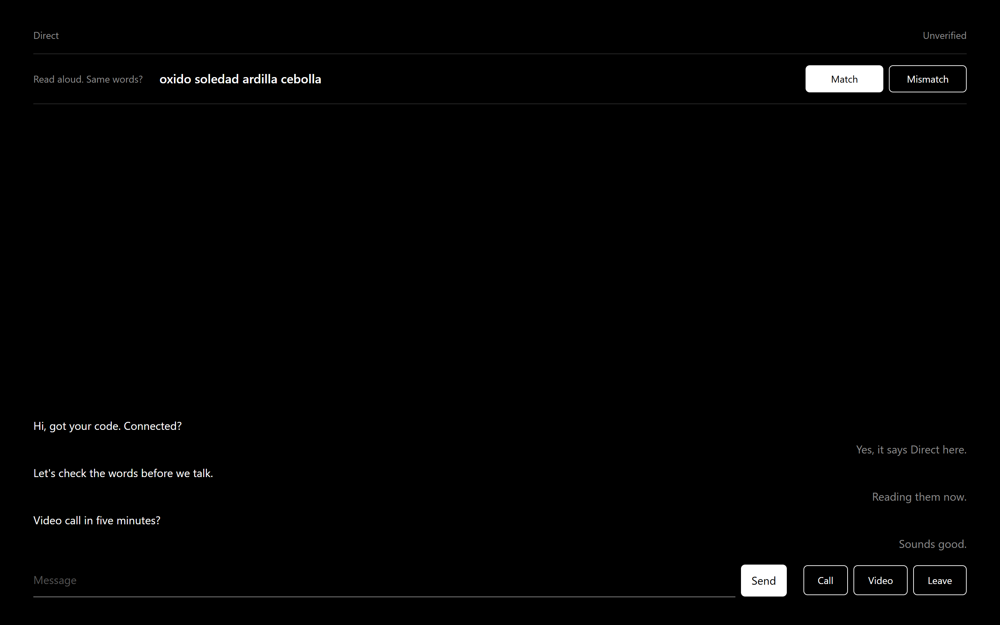
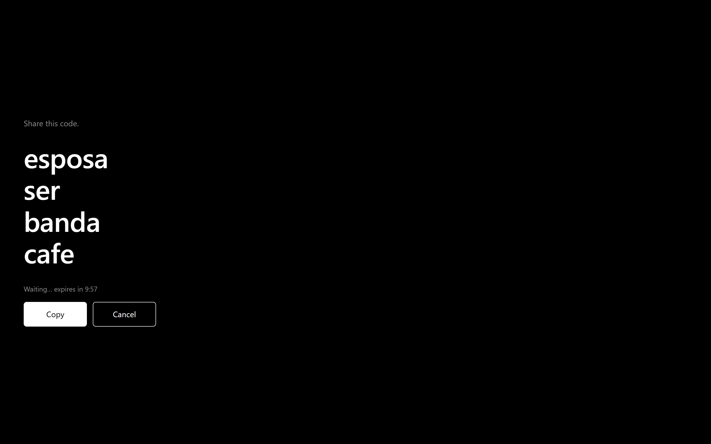
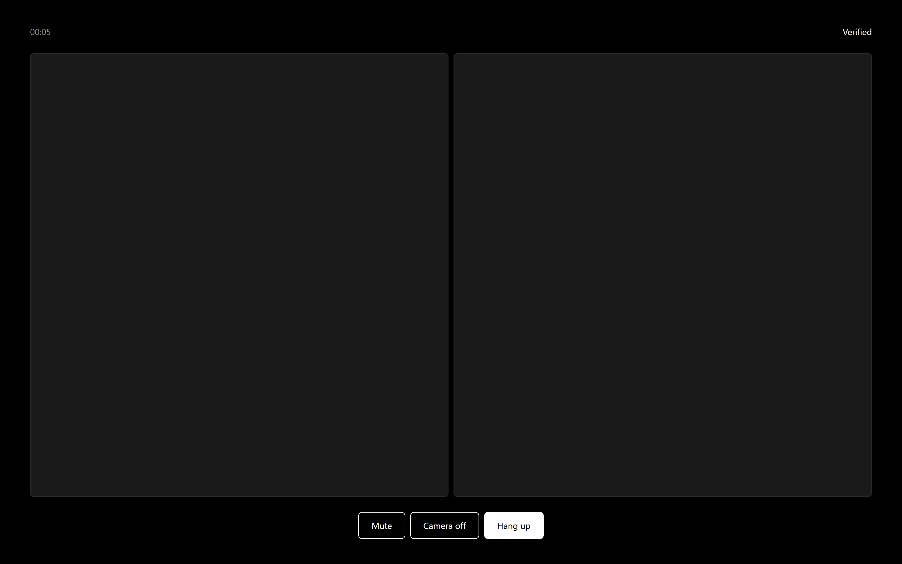
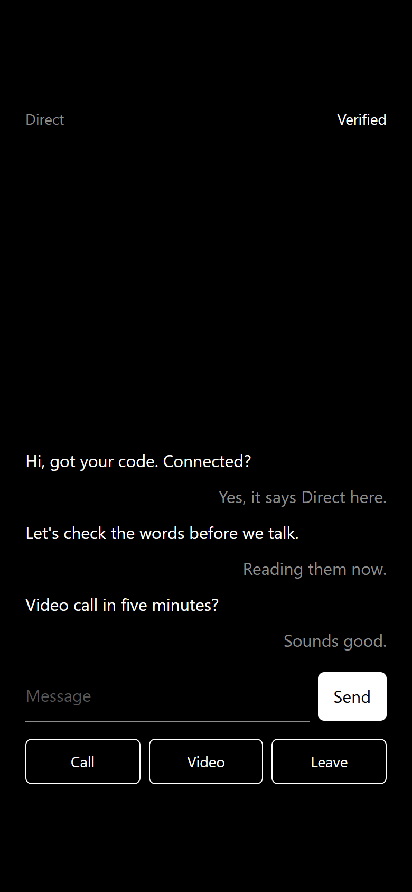

# p2pcomms

Private text, voice and video between two people. One HTML file, no account, no server in the middle.



## How it works

1. Open `p2pcomms.html` on your computer.
2. Press **New**. The app shows a 4-word code. Send it to the other person over any channel you trust, and keep the tab open.
3. The other person opens the same file, presses **Join**, types the code and presses **Connect**.
4. Once you are connected, both screens show 4 verification words. Read them aloud to each other. If they are the same, press **Match**. If not, press **Mismatch**: someone may be in the middle, and the app disconnects.

The code works for one connection and expires after 10 minutes. The code words and verification words are Spanish words; the interface is in English.

## Download

1. Go to [Releases](https://github.com/brunomick/p2pcomms/releases) and download `p2pcomms.html` and `SHA256SUMS`.
2. Save `p2pcomms.html` anywhere and double-click it. It opens in your browser from your disk. Use desktop Chrome or Edge.

Check that the file is the published one. Its SHA-256 hash must match the one in `SHA256SUMS`.

Linux, macOS or Git Bash (in the folder with both files):

```sh
sha256sum -c SHA256SUMS
```

Windows Command Prompt:

```bat
certutil -hashfile p2pcomms.html SHA256
```

Windows PowerShell:

```powershell
(Get-FileHash p2pcomms.html -Algorithm SHA256).Hash
```

On Windows, compare the printed hash with the one in `SHA256SUMS` (letter case does not matter).

## Features

- Text chat, voice calls and video calls, sent directly between the two browsers over WebRTC (DTLS for chat, SRTP for audio and video).
- A 4-word code (about 44 bits) instead of accounts. The code never leaves your computer: it is stretched with PBKDF2-SHA256 (600,000 iterations) into the room secrets.
- The handshake goes encrypted through public Nostr relays. The app closes its relay connections once you are connected.
- Verification words against a man-in-the-middle, computed with a commit-reveal exchange over the direct connection. Someone who knows the code can only make the words match by chance (1 in 2^44).
- The room is closed to two people. A third person with the same code is ignored.
- Calls only with consent. Calling never turns on the other person's camera or microphone. They see **Accept**, **Audio only** (video calls) or **Decline**, and their devices are requested only after they accept.
- Nothing is stored: no history, no `localStorage`, no cookies, no analytics.
- A single self-contained HTML file. It loads nothing from the internet, and its Content Security Policy only allows `wss:` connections.
- Reproducible build: the same release tag builds the same file, byte for byte.

## Privacy: what is and isn't exposed

The same list is in the app, under **Privacy** on the start screen.

- **The other person** sees your IP address.
- **Nostr relays** see IP addresses, a hashed room ID (not the code), encrypted handshake data and timing. The app closes these connections once you are connected.
- **A STUN server** (Google or Cloudflare) sees your IP address. It only tells your browser its public address.
- **Your ISP** sees two IP addresses exchanging encrypted data, not the content.
- **Nothing is stored.** Closing the tab ends everything.

Messages, audio and video go directly between the two computers, encrypted. There is no TURN server: if a direct connection is not possible, the connection fails instead of being relayed through a server.

## Limitations

- **Home networks only.** It does not work behind CGNAT, on mobile networks, or on most corporate networks. There is no TURN relay, by design. The app then says "No direct route. Likely CGNAT or a mobile/work network."
- **Desktop Chrome and Edge only.** Firefox is untested. Mobile browsers are not supported.
- **Two people only.** No groups.
- **No history.** Nothing is saved. If the connection drops, start again with a new code.
- **No file transfer** yet.
- It depends on public Nostr relays and third-party STUN servers to find each other. If they are down, connecting can be slow or fail.

## Screenshots

| Waiting for the other person | Video call | Phone width |
| --- | --- | --- |
|  |  |  |

## Build from source

You need Node 24 (see `.nvmrc`).

```sh
git clone https://github.com/brunomick/p2pcomms.git
cd p2pcomms
npm ci
npm test
npm run build
```

The result is `dist/p2pcomms.html` and `dist/SHA256SUMS`. The build is reproducible: if you check out a release tag (`git checkout vX.Y.Z`) and build it with Node 24, you get the same hash as the release, on Windows and Linux.

End-to-end test (needs a build first, Chrome, and internet; it uses the real public relays, so timing varies):

```sh
CHROME="C:/Program Files/Google/Chrome/Application/chrome.exe" npm run test:e2e
```

In PowerShell, set the path with `$env:CHROME = "..."` first. CI (`.github/workflows/verify.yml`) runs the unit tests and the build on every push and pull request. It does not run the end-to-end test.

### Releasing

1. `npm run release:hash` builds and copies `dist/SHA256SUMS` to the repository root.
2. Commit `SHA256SUMS`, then tag the release (`git tag vX.Y.Z`) and push the tag.
3. For the tag, CI rebuilds on Linux and checks the result against the committed `SHA256SUMS`. If it passes, attach `p2pcomms.html` and `SHA256SUMS` to the GitHub release.

## Security

See [SECURITY.md](SECURITY.md) for the threat model and how to report a vulnerability.

## License

[MIT](LICENSE). Third-party notices (Trystero, @noble/secp256k1, BIP-39 Spanish word list) are in [NOTICE](NOTICE).
